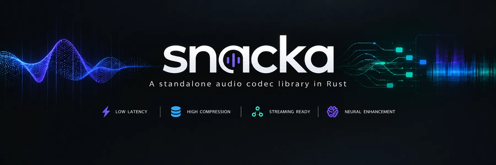

# snacka

An independently implemented, MIT-licensed Rust codec for interactive speech,
with its own versioned bitstream. Snacka is the codec under development;
external codecs are measurement competitors and test oracles only.

**Experimental DSP prototype.** It encodes and decodes audio today, but its
speech quality and loss concealment need substantial improvement before use in
production calls. No superiority over established codecs is claimed.

- Mono normalized f32 PCM at 48 kHz.
- 20 ms frames by default; optional 10 ms frames.
- 12–32 kb/s including four bytes of framing and checksum per packet.
- Bitrate changes retain stream history; fractional byte budgets remain exact.
- Per-packet coded bandwidth of 8/12/24 kHz; PCM stays at 48 kHz.
- 120 samples (2.5 ms) of transform delay beyond frame buffering.
- Caller-owned buffers; no allocation during encoding, decoding, concealment,
  bitrate updates or reset. Each track owns its independent history.
- Default library builds have no dependencies, build script, C, FFI, CMake or unsafe Rust.

The encoder uses a short-overlap MDCT, sparse spectral selection, adaptive
four- or six-bit quantization, adaptive coded bandwidth
and arithmetic coding. A second spectral model independently codes four band
gains and normalized signed-pulse vectors. Each packet chooses the model and
bandwidth with greatest full-spectrum error reduction. The decoder validates framing,
CRC, stream sequence and spectral bounds, with explicit concealment for missing
packets. CRC detects corruption; authentication belongs to the transport.
Pulse gain precision adapts to the packet budget, retaining more shape bits at
low bitrate. Signed pulse classes recover additional shape bits without increasing
packet size. The experimental format is version 7. Encoder and decoder must use the same
version and support every negotiated profile; older native packets are rejected.
The opt-in harmonic speech model can emit profiles 14/15, which earlier version-7
decoders reject. `Config::with_harmonic_speech(true)` requires peer support for
these profiles and increases encoder CPU at 12–16 kb/s. It is disabled by default.

```rust
use snacka::{Config, Decoder, Encoder, FRAME_SAMPLES, MAX_PACKET_BYTES};

let mut encoder = Encoder::new(Config::default());
let mut decoder = Decoder::new();
let input = [0.0; FRAME_SAMPLES];
let mut packet = [0; MAX_PACKET_BYTES];
let mut output = [0.0; FRAME_SAMPLES];
let length = encoder.encode(&input, &mut packet).unwrap();
let frame = decoder.decode(&packet[..length], &mut output).unwrap();
assert_eq!(frame.valid_samples, FRAME_SAMPLES);
```

Discard the first `ALGORITHMIC_DELAY` output samples once per stream. At its
end, encode and decode `Encoder::finish` and retain the drain's
`FrameInfo::valid_samples` prefix. The offline example handles this alignment
and partial input frames:

```sh
cargo run --release --example roundtrip -- input.f32 output.f32 24000 20
```

To hear your microphone through Snacka in real time, put on headphones and run
the optional Ratatui listening lab:

```sh
cargo run --release --features live-audio --example monitor
```

Press **Space** to compare codec and raw audio, **Left/Right** to change bitrate,
**Up/Down** for volume, **F** for 10/20 ms frames, **H** for experimental harmonic
speech, **B** for buffering, and **Q** to
quit. The dashboard shows microphone activity, device routing and stream health.
It starts at 24 kb/s and 50% playback gain; no audio is saved. See
[the listening guide](docs/monitor.md) for devices, Linux build prerequisites and
latency details. Audio/TUI dependencies are enabled only by `live-audio`.

Rust 1.99 or newer is required. Plans allocate during construction, before the
audio callback. Snacka operates on PCM and packet bytes; capture, playback,
echo cancellation, resampling, encryption, jitter buffering and relaying remain
application responsibilities. A relay can forward bytes and send separate copies
to an analysis pipeline without delaying participant audio.

```sh
cargo test --locked
cargo test --locked --release
cargo clippy --locked --all-targets -- -D warnings
cargo bench --locked --bench kernels
```

For an optional CPU comparison against a separately installed libopus:

```sh
cargo bench --locked --bench kernels --features reference-tests
```

This benchmark alone contains reference FFI. Supply a nonstandard search path
with `RUSTFLAGS="-L /path/to/lib"`. Neither the feature nor normal builds add
reference code or linkage to the library.

The optional [matched speech-quality reference](docs/reference-quality.md) uses
a separately installed external library only in an offline Python tool. It
records quality gaps alongside wins at equal bitrate, frame duration and delay.

See [the bitstream](docs/bitstream.md), [development and acceptance](docs/implementation.md),
[measurements](docs/measurements.md), [signed pulse classes](docs/pulse-classes.md), [harmonic speech experiment](docs/harmonic-speech.md), [harmonic analysis performance](docs/harmonic-analysis.md), [paired speech CPU probes](docs/cpu.md), [quality evaluation](docs/quality.md), [packet-loss evaluation](docs/loss.md), [fixture provenance](tests/fixtures/README.md)
and [fuzzing](fuzz/README.md). The implementation license is [MIT](LICENSE).
External reference source and trained weights are not vendored.
