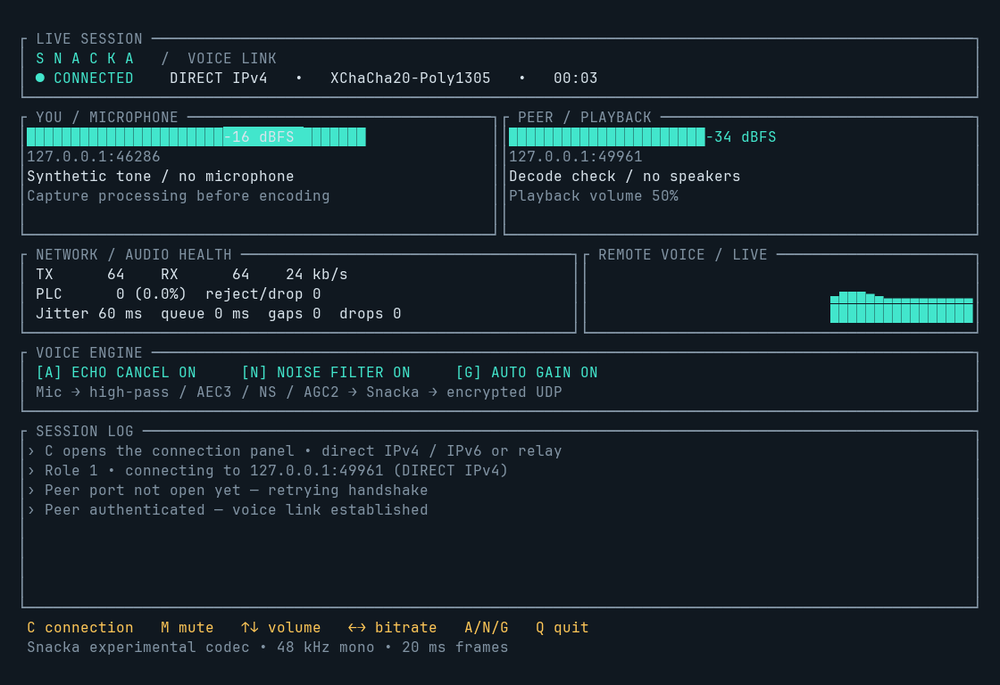
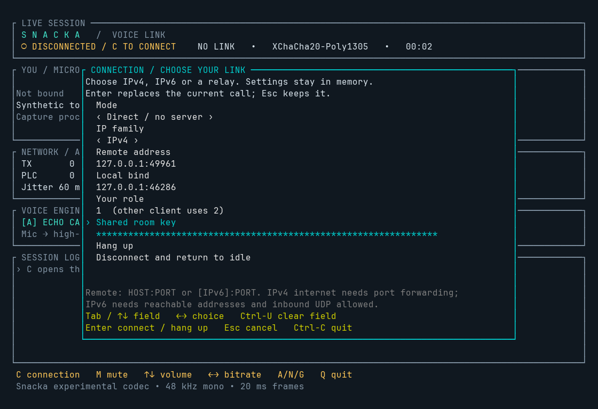

# Snacka / Voice Link

The `call` example connects two native clients using Snacka's actual codec and
encrypted UDP. Its Ratatui dashboard has separate microphone and playback meters,
remote voice history, device routing, a session log and packet/audio health.
It defaults to 48 kHz mono, 20 ms frames, 24 kb/s, 60 ms of jitter buffering and
50% playback volume. No audio is saved.



Live dashboard from two device-free test clients connected directly over IPv4
loopback. The meters use a logarithmic -60 to 0 dBFS scale.

## Choose the connection in the TUI

Start the client in a terminal without connection arguments:

```sh
target/release/examples/call
```

The connection panel opens before any microphone or speaker is opened. Choose
**Direct** or **UDP relay**, **IPv4 / IPv6 / Automatic**, the remote address and
port, local bind (leave empty for automatic), role 1 or 2 and a shared room key.
The key is masked, can be pasted, and is prefilled from `SNACKA_CALL_KEY` when set.
Settings stay in memory and are not written to disk. Generate a fresh key with
`call --generate-key` and use that same key on the other client and any relay.



Use Tab or Up/Down to select a field, Left/Right to change choices, and Ctrl-U to
clear a text field. Enter connects; Esc cancels. Press **C** during a call to edit
the destination. Editing keeps the current call running; applying a valid new
connection hangs up the old call, releases its local socket and starts fresh
audio/codec/crypto state. Choose the **Hang up** row and press Enter to disconnect
while keeping the client open.

Address/key errors are shown inside the panel. In TUI mode a failed handshake
returns to the panel so you can correct settings and retry; plain CLI mode exits
with an error. A bind failure after releasing the previous socket leaves the
client disconnected. Start both endpoints within ten seconds of connecting, or
press Enter to retry once the other client is ready.

## Direct IPv4: LAN or port forwarding

Select IPv4 in the connection panel, or pass `--ipv4`. On a LAN, use the other
computer's LAN IPv4 address and allow inbound UDP port 5000 on both machines.
For example, with A at `192.168.1.10` and B at `192.168.1.11`:

```sh
# A (same SNACKA_CALL_KEY on both computers)
target/release/examples/call --ipv4 --peer 192.168.1.11:5000 --role 1
# B
target/release/examples/call --ipv4 --peer 192.168.1.10:5000 --role 2
```

Across the public internet, use each router's public IPv4 address, forward the
chosen UDP port to the corresponding computer on **both** routers, and allow
that port in both host firewalls. If the external port differs, enter the external
port in the other client's remote address and the internal port in the local
bind. The connected UDP socket expects packets from the configured IP **and
port**, so the forwarded port must also match the actual outbound source port.
Some NAT devices rewrite that source port. Carrier-grade NAT or a network where
you cannot configure forwarding generally needs the relay mode below. Selecting
IPv4 does not automatically traverse NAT or discover your public address.

`--ipv4` and `--ipv6` also constrain hostname resolution. Automatic chooses the
first address matching any explicit local bind; it does not race IPv4 and IPv6
or automatically fall back after a failed handshake.

## Direct IPv6: no server

Both computers need reachable **global IPv6 addresses**. On Linux, inspect
`ip -6 addr show scope global`; on macOS, inspect `ifconfig`; on Windows, inspect
`ipconfig`. A `fe80::` link-local address or `fc00::/7` private address is unsuitable
for a direct public internet call. Use an address that remains valid for the test,
including when the computer has temporary/privacy addresses.

Allow inbound **UDP port 5000** on each computer and its router's IPv6 firewall,
preferably restricted to the other client's IPv6 address. IPv6 does not eliminate
firewalls. There is no STUN, ICE, hole punching or automatic discovery in this
example; exchange addresses, ports and a key yourselves.

Build on both computers (Rust 1.99+, Linux also needs ALSA headers/pkg-config as
described in [the monitor guide](monitor.md)):

```sh
cargo build --locked --release --features internet-call --example call
```

On one computer, generate a random key and share it privately with the other
participant:

```sh
target/release/examples/call --generate-key
```

Set `SNACKA_CALL_KEY` to those same **64 hex digits** in both terminals. Choose
different roles: client A is 1, client B is 2. The addresses below are documentation
placeholders: replace them with your actual global addresses.

Client A (suppose A's address is `2001:db8:1::a`):

```sh
export SNACKA_CALL_KEY=PASTE_THE_GENERATED_64_HEX_DIGITS
target/release/examples/call \
  --bind '[::]:5000' --peer '[2001:db8:2::b]:5000' --role 1
```

Client B (suppose B's address is `2001:db8:2::b`):

```sh
export SNACKA_CALL_KEY=PASTE_THE_SAME_64_HEX_DIGITS
target/release/examples/call \
  --bind '[::]:5000' --peer '[2001:db8:1::a]:5000' --role 2
```

PowerShell uses `$env:SNACKA_CALL_KEY = "..."` and the Windows binary is
`target/release/examples/call.exe`. Start both clients within ten seconds, or
retry in the TUI if the handshake times out. The connecting dashboard is visible
immediately; audio devices open after an authenticated response. `--ipv6`
explicitly selects IPv6 when resolving a hostname.

Each client sends directly to the other. No third machine, account, certificate
or external relay is used. The UDP socket accepts traffic from the configured
remote endpoint only. If the machine has several IPv6 addresses, bind its exact
advertised address instead of `[::]` so replies use the expected source address.
Direct IPv4 also works with `--peer HOST:PORT` and `--bind 0.0.0.0:PORT` when both
endpoints are reachable (for example, on a LAN or with port forwarding).

## Dashboard controls

| Key | Action |
| --- | --- |
| C | Choose/change destination, IP family, mode, role, key; hang up |
| M | Mute/unmute outgoing microphone audio |
| Up / Down | Playback volume, 0–100% |
| Left / Right | Encoder bitrate, 12–32 kb/s; stream history retained |
| A | Enable/disable AEC3 echo cancellation |
| N | Enable/disable noise suppression |
| G | Enable/disable adaptive digital gain control |
| Q / Esc / Ctrl-C | Hang up and restore the terminal |

Processing toggles rebuild the voice engine; its adaptive filters need to settle
again. Muting still processes the capture/reference streams so the AEC keeps
adapting. Use a terminal at least 64 columns by 25 rows; 100 by 32 gives the full
panel more space. Smaller terminals use a compact status display. In a redirected
session, or with `--no-tui`, the example prints status once per second.

`TX` and `RX` count audio packets. `PLC` counts missing or undecodable frames
replaced by the codec's packet-loss concealment; its percentage includes every
scheduled missing frame, including an outage. Reject/drop counts include malformed,
unauthenticated, replayed and late packets. Audio gaps and drops count 48 kHz
samples; the playback queue and jitter target are **not end-to-end latency**.
There is no round-trip latency measurement in this example.

Use `--list-devices`, `--input INDEX` and `--output INDEX` to select devices:

```sh
target/release/examples/call --list-devices
target/release/examples/call --peer '[OTHER_IPV6]:5000' --role 1 \
  --input 0 --output 1 --gain 0.3 --buffer-ms 100
```

Non-48 kHz devices are resampled, and multichannel capture is averaged to mono.
Bluetooth audio can introduce substantial buffering. Stream errors stop the call;
disconnecting/replugging an audio device requires restarting the client.

## Echo and voice processing

The optional [Sonora](https://github.com/dignifiedquire/sonora) dependency supplies
a Rust implementation of WebRTC AEC3, noise suppression, AGC2 and high-pass
filtering. These operate on 10 ms blocks before the Snacka encoder. Adaptive
digital gain starts at 0 dB and is limited to 20 dB; output is constrained to the
codec's normalized range.

The echo reference is tapped in the **playback callback**, after gain and device
resampling. It includes actual priming silence and underruns, rather than merely
the last decoded packet. A bounded queue returns it to the voice engine at 48 kHz.
AEC3 estimates the remaining acoustic/device delay. Processing and network I/O
run on the main worker; audio callbacks use preallocated resamplers and bounded
lock-free sample queues. The reference tap is disabled in the existing monitor.

Start at a modest speaker volume and let the filter adapt. Headphones remain
useful for a baseline codec comparison. Synthetic AEC tests exercise a delayed
broadband echo path; they do not guarantee performance with your speakers,
microphone, nonlinear clipping, Bluetooth latency or independent device clocks.
For a real test, have A speak while B listens over speakers, then swap, and then
try both talking at once. Toggle A to compare the echo heard by the remote person.

## Optional relay

If either network cannot accept direct UDP, run the included `call_relay` on a
server reachable by **both** clients. Only the server needs an open UDP port.
Both clients initiate outbound UDP, which accommodates ordinary NAT setups;
networks that block UDP altogether still cannot use this example.

Server:

```sh
cargo build --locked --release --features call-transport --example call_relay
export SNACKA_CALL_KEY=THE_SAME_RANDOM_ROOM_KEY
target/release/examples/call_relay --bind 0.0.0.0:5000
# IPv6 listener: --bind '[::]:5000'
```

Client A and B:

```sh
# A
target/release/examples/call --relay SERVER_ADDRESS:5000 --role 1
# B
target/release/examples/call --relay SERVER_ADDRESS:5000 --role 2
```

One relay process hosts one room with two leased roles. A third client attempting
an occupied role gets an explicit error. Keepalives run once per second, clean
hangup frees the role, and a crashed client's lease expires after ten seconds.
An IPv6 listener's IPv4 compatibility depends on the operating system; use the
same address family on both clients for a portable setup. Hostname lookup chooses
the first matching address; specify a numeric address or an explicit `--bind`
family if necessary.

## Transport and limits

Datagrams use XChaCha20-Poly1305 with an OS-random 128-bit process/session prefix
and a checked 64-bit counter. Headers and payloads are authenticated; a sliding
replay window allows packet reordering within the active session. Each direction
has an independent random session prefix. Peer restart resets receive/decoder
state; late joining aligns the codec's modulo-256 sequence.

The key authenticates everyone in the room. Keep it private and generate a fresh
key for each test. In direct mode only the clients have it. **In relay mode the
relay also has the key and is trusted to read audio**; this is not end-to-end
encryption against that relay. There is no forward secrecy, identity service or
production-grade handshake protocol.

The bounded jitter buffer reorders packets, drops late/duplicate frames, conceals
loss and resynchronizes after large gaps. Playback queue growth is capped by
dropping whole frames; this example does not implement adaptive clock-drift
resampling. Snacka remains an experimental codec and this calling layer remains
a test application, not a production VoIP stack.

## Device-free checks

On a single machine, test **direct IPv4 without a relay** in two terminals, with
the same random `SNACKA_CALL_KEY` exported in each:

```sh
# Terminal A
target/release/examples/call --ipv4 --bind 127.0.0.1:5000 --peer 127.0.0.1:5001 \
  --role 1 --test-tone --no-tui --seconds 5
# Terminal B
target/release/examples/call --ipv4 --bind 127.0.0.1:5001 --peer 127.0.0.1:5000 \
  --role 2 --test-tone --no-tui --seconds 5
```

For **direct IPv6**, use the same key and these addresses:

```sh
# Terminal A
target/release/examples/call --bind '[::1]:5000' --peer '[::1]:5001' \
  --role 1 --test-tone --no-tui --seconds 5
# Terminal B
target/release/examples/call --bind '[::1]:5001' --peer '[::1]:5000' \
  --role 2 --test-tone --no-tui --seconds 5
```

`--test-tone` opens no microphone or speaker. It sends a synthetic tone through
voice processing, the codec and encrypted UDP, and decodes the other client's
audio. Both should report increasing TX, RX and decoded counts. Omit `--no-tui`
to inspect the live dashboard without audio devices. This checks the application
path, not public internet reachability or acoustic echo quality.

For an automated two-process IPv4/IPv6/relay smoke test and developer checks:

```sh
cargo build --locked --release --features internet-call --example call --example call_relay
python3 tools/smoke_call.py
cargo test --locked --features internet-call --example call --example call_relay --example monitor
cargo clippy --locked --all-targets --features internet-call -- -D warnings
```
