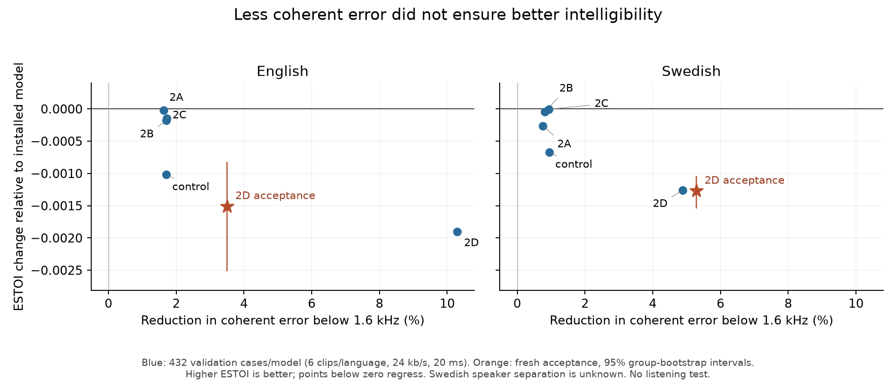

# Native neural PLC: Step 2 loss ablation

Experiment: 2026-10-22. Frozen installed baseline: `0456625a7603a368339194d0e42e472ce933e4a4` (PR #28).

**Decision: retain the installed 60-epoch model.** All four proposed loss variants were trained and decoded. Validation-selected 2D reduces waveform/coherent error on the fresh selection but worsens intelligibility and full-band spectral metrics, and fails both acceptance protocols. Only experiment/reproduction tools and this report are added to main; no runtime weights are promoted.

## Controlled experiment

The [protocol](neural-plc-loss-ablation-protocol.json) was committed as `8c0a296` before training. All five models use the same 80 → 64 → 64 → 16 MLP, int8 weights, f32 activations, seed 20261022, AdamW at 0.002, batch 8192, ten float epochs followed by QAT through epoch 60. The best eligible quantized checkpoint is selected by that experiment's validation objective. Array payload remains 11,392 bytes. No recurrent state, pitch head or noise head was added.

| Experiment | Loss and physical amplitude-gain range |
|---|---|
| Control | Full-band normalized MDCT error + 0.1 log-band-energy loss + 0.01 identity regularization; [0.7875, 1.2125]. |
| 2A | MDCT error only below the native 1,600 Hz band edge; log-band energy across supported bands; same range. |
| 2B | 2A with 2.5× penalty for log-energy overshoot. |
| 2C | 2B plus 0.1 native inverse/OLA sequence MR-STFT loss, FFT sizes 128/256/512, quarter-window hops. |
| 2D | Validation-selected loss from 2A–2C, with [0.50, 1.25] gains and an identity-initialized affine tanh head. |

The 1,600 Hz cutoff is the closest existing native band boundary to the proposed 1,500 Hz. It is a registered hypothesis, not a universal physical breakpoint. The matched control optimizes *applied* tight gains; it is not a numerical reproduction of the installed model's older raw-gain training followed by strength 0.425.

The common validation score is normalized low-band error + 0.1 symmetric masked log-band error + 0.1 sequence MR-STFT, balanced between languages. It selected **2A as the parent loss for 2D**, then **2D as the sole acceptance candidate**. The subsequent decoded validation results did not change that choice. This avoids selecting a fallback after inspecting acceptance data.

The actual training scripts match immutable Git source `409363e`; later commits harden metadata/matrix checks and add descriptive high-band reporting. Training reports bind the protocol, feature shards, sequence provenance and exported weight hashes. Experimental arrays require the matching `training-report.json` and affine gain head; they are not standalone replacements for the installed legacy strength export. The diagnostic builder verifies that pairing.

## Data and native synthesis

Feature training reused **470,922 training and 67,515 validation records**, staged directly from private Drive archives into Colab. No test features or raw test audio entered GPU training. The sequence supplement contains **64 training utterances / 1,525 events** and **24 validation utterances / 632 events**, spanning 10/20 ms and 1/2/4/6 lost-frame bursts. English auxiliary training covers 16 speakers; validation covers 12 distinct speakers. Swedish groups are sentence IDs, with unknown speaker separation.

The Rust exporter captures actual classical PLC coefficients and features, the previous 120-sample overlap, the lost burst, and the first received recovery coefficients/PCM. The inverse basis comes from the native Rust transform, not a generic half-frame-overlap MDCT. Every exported sequence passed NumPy/native identity-gain PCM parity (maximum error 1.19e-6). An independent PyTorch CPU f32 replay passed all 2,157 sequences (maximum error 1.31e-6); a separate finite-difference gradient check was within 1.45e-11. Direct CUDA waveform parity was not separately recorded. Exported GPU network gains passed native Rust parity for 32 fixtures per candidate, maximum error below 8.35e-7.

Sequence MR-STFT includes the initial native overlap and loss → recovery boundary; it does **not** append a full preceding good frame. Training targets are the uninterrupted, Phase-1-refined *decoded codec* signal. ESTOI instead compares against original clean speech. This target/context mismatch remains a plausible limitation, not an isolated causal explanation.

For native 16 kHz Swedish, the log-energy objective excludes the crossing 6.8–9 kHz band and bands above it. MR-STFT uses bins through 8 kHz. Thus the native high-band envelope report covers 1.6–6.8 kHz for Swedish and 1.6–24 kHz for English. Upsampling does not establish Swedish fullband performance.

The fresh acceptance selection has **24 utterances / 198.20 seconds**: 12 VCTK speakers (46.46 s) and 12 new FLEURS Swedish sentence groups (151.74 s). Their audio and exact native PCM hashes do not overlap training/validation or prior oracle audio. The English speakers are disjoint from feature training/validation, but are the **same held-out speakers used for other utterances in the oracle study**. They are not design-unseen voices. Swedish speaker separation remains unknown. English clips range 1.75–7.54 s; Swedish clips 7.74–22.08 s.

## Decoded validation

This diagnostic subset contains 432 cases per model: six clips per language, 24 kb/s, 20 ms, default/harmonic modes, three noise conditions and six loss patterns. Values below are changes relative to the installed model, shown as **English / Swedish**. Lower error is better; positive ESTOI is better. These are validation points, not independent acceptance or listening results.

| Variant | Low-band MSE Δ | Full-envelope error Δ | MR-STFT error Δ | ESTOI Δ |
|---|---:|---:|---:|---:|
| control | -1.71% / -0.95% | +7.01% / +5.62% | -0.43% / +1.59% | -0.001017 / -0.000670 |
| 2A | -1.62% / -0.76% | -1.08% / -0.54% | +1.73% / +0.45% | -0.000021 / -0.000261 |
| 2B | -1.71% / -0.82% | +1.40% / +0.93% | +0.08% / +0.24% | -0.000181 / -0.000045 |
| 2C | -1.72% / -0.94% | +2.20% / +1.56% | -1.04% / +0.20% | -0.000146 / -0.000005 |
| 2D | -10.29% / -4.89% | +1.69% / +2.42% | +2.16% / +0.81% | -0.001903 / -0.001259 |

All four loss variants had negative mean ESTOI changes on both languages here. 2A improved coarse envelope error without improving ESTOI; 2C improved English MR-STFT without improving both-language intelligibility. The common training/validation proxy still ranked 2D first. Future selection should therefore apply native perceptual validation constraints before ranking candidates by a composite proxy.

Across epoch 50 → 60, validation objectives changed by 0.00% (control), −0.0645% (2A), −0.0656% (2B), −0.0105% (2C), and −0.0962% (2D). These diminishing objective gains do not establish a causal capacity ceiling or prove that more epochs would improve perception.

## Fresh acceptance

Both installed and selected models were freshly decoded over **5,184 matched cases each**: 24 clips × 3 bitrates × 2 durations × 2 modes × 3 conditions × 6 loss patterns. Each run also decodes classical PLC independently. No previous candidate quality cache was used.

The new acceptance protocol evaluates exact native coherent MDCT error below 1.6 kHz, phase-insensitive band-envelope and whole-clip MR-STFT error, and clean-reference STOI/ESTOI. It permits worse total waveform MSE, while retaining low-band, transition and worst-decile guards. The old [acceptance protocol](neural-plc-acceptance.json) is reported separately; its 0.25 dB threshold is against classical PLC (about 5.6% less error), not a requirement to beat the installed 7% figure.

| 2D relative to installed | English | Swedish |
|---|---:|---:|
| Coherent low-band error | -3.50% | -5.29% |
| Whole lost-waveform error | -3.20% | -3.84% |
| Low-band log-envelope error | +4.33% | +8.56% |
| High-band log-envelope error | -0.42% | -0.18% |
| Full-band log-envelope error | +2.00% | +6.01% |
| Whole-clip MR-STFT error | +1.99% | +1.05% |
| STOI change | -0.001920 | -0.001351 |
| ESTOI change | -0.001508 | -0.001270 |
| ESTOI group-bootstrap 95% interval | [-0.002510, -0.000826] | [-0.001532, -0.001050] |

**The revised gate fails 19 conditions.** Both languages regress in full-envelope, MR-STFT, STOI and ESTOI, all eight mode/duration ESTOI strata fail, and onset/worst-decile guards also fail. The high-band supplement passed exact replay identity checks for all 5,184 cases per variant.

The low-band envelope worsens even while low-band coherent MSE improves. For an unregularized fixed band, the MSE-optimal gain is `rho * sqrt(target_energy / prediction_energy)`, whereas the envelope optimum omits `rho`. Positive correlation below 1.6 kHz still permits attenuation to win MSE when correlation is less than one. The observations are consistent with that tradeoff; they do not isolate a pitch mechanism.

Against classical PLC, installed lost-waveform error reductions are **5.34% / 6.57%**, and 2D gives **8.37% / 10.15%**. The earlier approximately 7% result used different utterances. The installed model itself misses the legacy English aggregate threshold on this fresh cohort (5.34% reduction versus about 5.59% required); all its other legacy quality conditions pass. Its mean ESTOI changes against classical PLC are -0.000394 / -0.000280. Keeping the existing baseline is not a new claim of perceptual acceptance.

2D also fails the legacy intelligibility and worst-decile gates, despite passing its aggregate error-energy threshold. Full raw failure lists are retained in the [results JSON](neural-plc-loss-ablation-results.json).



High-band envelope measurements were added by a separate native-only replay because the initial quality CSV did not retain them separately. Their executable hashes, case sets, input hashes, group metadata, and original native error/envelope statistics must match the corresponding quality run exactly before those descriptive measurements are combined. This addition does not alter the frozen acceptance thresholds.

The group bootstrap is stratified by language, with 10,000 replicates and seed 20261022. English units are speakers; Swedish units are sentence groups. The latter cannot establish independent-speaker confidence. These scores are objective proxies, not evidence of an audible improvement or a comparison against Opus.

## Runtime and resources

Both installed and experimental 2D copies passed the existing **26 codec tests and 3 allocation tests**, including active neural concealment, reset/refusal, bounded long-loss silence, uninterrupted decode and overlap recovery. Typed model constants remain 11,392 bytes and Decoder is 16,288 bytes on the measured arm64 host. The existing native kernel benchmark on Apple M5 measured first-loss medians around 14–18 µs for both variants. Tail samples sometimes exceeded 25 µs; this is not a worst-case deadline guarantee. Instrumented quality-replay timings are not used as production CPU evidence.

A separate sweep compared full packet payloads and uninterrupted native PCM **bit-exactly in 864 input/profile combinations**. The complete quality runs also enforce finite/bounded PCM and exact received PCM beyond the 120-sample recovery overlap.

The five GPU training loops took **137.5 seconds** in total, excluding staging/startup. The entire campaign, including CPU validation/acceptance, the extra high-band replay and evidence persistence, consumed approximately **0.42 CU**. The final balance was **1,021.14 CU**. All four owned runtimes (one L4 and three CPU sessions) were confirmed stopped, with zero active assignments and 0.00 CU/hour at 2026-10-22T04:30:49.163686+00:00.

Raw sources, sequences, canonical clean/noisy input fingerprints, all candidate artifacts and full evidence are retained privately on Drive. Training/quality computation ran in Colab. Temporary upload archives were deleted from the Mac after full Drive checksum readback; compact weights/reports/receipts remain locally. No source under `src/opus/`, packet format, encoder, Phase 1 weights or runtime dependencies was changed by this study.

## Reproduction

Use the frozen training-source revision and the checksummed private data archives from the evidence index. A typical experiment is:

```sh
python tools/train_plc_ablation.py features sequences out-2A \
  --protocol docs/neural-plc-loss-ablation-protocol.json --experiment 2A
python tools/build_plc_ablation.py /tmp/native-2A \
  --weights out-2A/neural_plc_weights.rs
python tools/evaluate_plc_ablation.py selection.json acceptance.csv \
  --binary /tmp/native-2A/target/release/examples/plc_ablation_compare \
  --quality --workers 2
python tools/summarize_plc_ablation.py installed.csv acceptance.csv \
  --protocol docs/neural-plc-loss-ablation-protocol.json --output decision.json
python tools/test_plc_ablation_gate.py
```

Use the retained original environments/canonical PCM for exact input reproduction. Standalone Rust builds use fresh dependency-free source copies and record source/hook/binary hashes. Nine synthetic gate-contract tests cover valid perceptual tradeoffs, ESTOI/low-band/worst-decile regressions, incomplete matrices, non-finite scores and stale supplement identities. They are gate tests, not quality data.

The [machine-readable report](neural-plc-loss-ablation-results.json) records protocol/source/weight/CSV hashes, all decisions and artifact checksums. The owner’s private evidence index binds those checksums to Drive file IDs. Both canonical language archives and the full evidence bundle were uploaded and fully read back with SHA256 verification. Signed download URLs, private launchers, CLI credential histories and raw corpus audio are excluded from the evidence bundle.


## Questions for the next iteration

Prioritize alignment between the training target and native perceptual validation before adding epochs or parameters. The current sequence target is decoded codec audio, while ESTOI uses original clean speech, and the short MR-STFT window omits a full preceding good frame. Native perceptual validation should also be an admission guard before composite-score selection. A subsequent representation oracle for fractional pitch/noise mixing could test structural headroom before a compact temporal model is trained. Fullband Swedish and reliable speaker separation remain data gaps. None of these observations proves a universal causal ceiling or guarantees that a GRU will improve quality.
