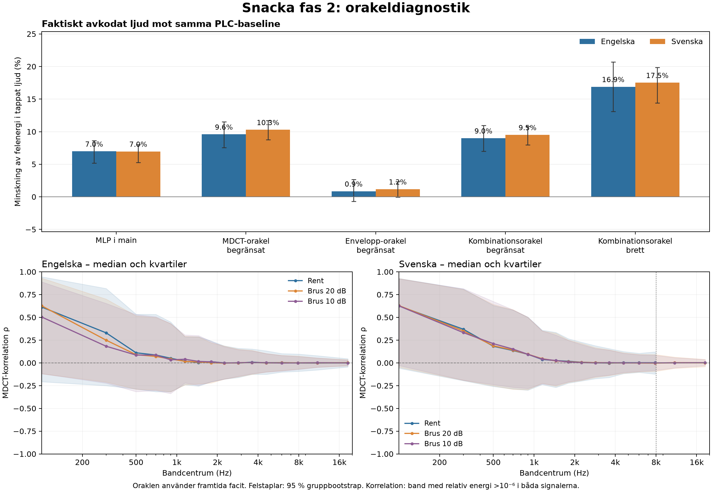

# Native PLC oracle diagnostic

Baseline source: `cf5ed449a0e3fb8ff168d290f843d0ed460aa4fb`.
This is a noncausal diagnostic, not a replacement model or a new acceptance
test. The 24 previously scored clips produce 5,184 cases per variant over the
original bitrates, durations, modes, noise conditions and loss masks. Speaker
and sentence groups retain their original identities. See
`neural-plc-oracle-protocol.json` for the matrix and provenance fingerprints.

## Results: complete frozen matrix

All 5,184 cases per variant completed: **31,104 waveform rows**. No training
or runtime/model change was made. The baseline below is classical native PLC
with the same Phase 1 postfilter. It is not an Opus comparison. Tight gains
are 0.7875–1.2125; wide gains are 0.5–1.5. Every oracle sees future targets.



### Actual decoded waveform

Lower lost-sample error energy versus baseline (%); brackets show the 95%
group-bootstrap interval. Each language has 2,592 cases and twelve groups.
Swedish groups are sentences, so these intervals do not establish
speaker-independent uncertainty. Error-energy percentages are not percentages
of perceived speech-quality improvement.

| Variant | English | Swedish |
| --- | ---: | ---: |
| Current 60-epoch MLP | 6.979 [5.192, 8.633] | 6.963 [5.280, 8.036] |
| MDCT, tight | 9.589 [7.539, 11.536] | 10.289 [8.746, 11.699] |
| Envelope, tight | 0.856 [-0.671, 2.670] | 1.173 [-0.033, 2.339] |
| Combined, tight | 8.998 [6.989, 10.947] | 9.508 [7.970, 10.836] |
| Combined, wide | 16.890 [13.088, 20.675] | 17.517 [14.423, 19.871] |

Whole-clip quality-score deltas versus baseline; higher STOI/ESTOI is better.
These scores compare with original clean PCM, while the error-energy table
compares with uninterrupted codec output. Full intervals, LSD, onset/recovery,
condition/mode strata and worse-case fractions are in the
[machine-readable report](neural-plc-oracle-results.json).

| Variant | EN ΔSTOI | EN ΔESTOI | SV ΔSTOI | SV ΔESTOI |
| --- | ---: | ---: | ---: | ---: |
| Current 60-epoch MLP | -0.000080 | +0.000149 | -0.000271 | -0.000467 |
| MDCT, tight | +0.000353 | +0.001126 | +0.000463 | +0.001196 |
| Envelope, tight | +0.002882 | +0.004045 | +0.004056 | +0.004027 |
| Combined, tight | +0.002078 | +0.002850 | +0.002956 | +0.002903 |
| Combined, wide | +0.003334 | +0.005022 | +0.004798 | +0.004987 |

The current model's Swedish ESTOI delta is -0.000467
(group bootstrap [-0.000777, -0.000189]); its STOI interval includes zero.
This is a small score regression, not evidence of improved intelligibility.
The envelope oracle improves STOI/ESTOI but has greater waveform error than
baseline in about 37% of cases. This is a real objective tradeoff. None of
these measurements is a blind listening result.

### Fixed-prediction ceiling and objective gap

The next table holds baseline PLC predictions and eligibility constant and
measures raw MDCT error across **all loss-frame occurrences**. These are not
waveform SNR or stateful native-oracle outcomes.

| Gain rule | EN MDCT error reduction (%) | SV MDCT error reduction (%) |
| --- | ---: | ---: |
| Current 60-epoch MLP | 7.358 | 7.210 |
| MDCT, tight | 10.142 | 10.816 |
| Envelope, tight | 1.179 | 1.384 |
| Combined, tight | 9.547 | 10.027 |
| Combined, wide | 17.972 | 18.543 |

The MDCT row is the constrained MDCT ceiling for these fixed predictions.
The wider gain interval leaves substantially more oracle headroom. A future
causal model may be unable to predict the required gains.

On the extractor-compatible subset, the current MLP captures **65.35% (EN)**
and **58.26% (SV)** of the possible reduction in the combined applied-gain
functional from identity to its tight oracle. Thus the combined functional
has a meaningful oracle gap even though the native waveform-error gap is
only a few percentage points. It is not valid to conclude that a causal MLP
has exhausted its capacity from this oracle alone.

The pooled, frame-weighted applied functional is 0.977274 at identity,
0.899866 for the MLP, and 0.849101 for the tight combined oracle. Solving the
original raw-gain training problem and applying strength 0.425 afterward gives
0.852853. That ideal strength-path penalty is only 0.003752 relative to the
applied-gain optimum. The strength mismatch is worth controlling in an
ablation, but it does not explain most of the learned-model gap. These are
heldout diagnostic functionals, not recovered checkpoint validation scores.

### Correlation across all 16 bands

Pooled English/Swedish and clean/noisy **runtime-eligible** frame occurrences.
Both signals must have relative band energy above 1e-6. The JSON also records
all nonzero-energy quartiles, undefined counts and separate language/condition
tables. Repeated masks and frame occurrences are not independent speakers.

| Band (Hz) | Supported occurrences | ρ Q25 | ρ median | ρ Q75 |
| --- | ---: | ---: | ---: | ---: |
| 0–200 | 197,894 | -0.0705 | +0.6157 | +0.9258 |
| 200–400 | 183,242 | -0.2010 | +0.3271 | +0.7978 |
| 400–600 | 174,118 | -0.2616 | +0.1684 | +0.6229 |
| 600–800 | 155,848 | -0.2884 | +0.1276 | +0.5663 |
| 800–1000 | 140,701 | -0.2998 | +0.0827 | +0.4862 |
| 1000–1300 | 139,493 | -0.2312 | +0.0372 | +0.3400 |
| 1300–1600 | 137,020 | -0.2547 | +0.0208 | +0.3146 |
| 1600–2000 | 141,380 | -0.2141 | +0.0117 | +0.2487 |
| 2000–2500 | 143,905 | -0.1887 | +0.0030 | +0.2064 |
| 2500–3200 | 137,294 | -0.1582 | +0.0012 | +0.1651 |
| 3200–4000 | 125,706 | -0.1387 | +0.0013 | +0.1435 |
| 4000–5200 | 143,723 | -0.1102 | +0.0005 | +0.1116 |
| 5200–6800 | 137,172 | -0.0960 | -0.0002 | +0.0924 |
| 6800–9000 | 116,917 | -0.0883 | -0.0006 | +0.0884 |
| 9000–13000 | 39,175 | -0.0529 | +0.0007 | +0.0572 |
| 13000–24000 | 22,469 | -0.0346 | +0.0009 | +0.0366 |

The supported median falls from about 0.616 below 200 Hz to 0.012 at
1.6–2 kHz and 0.003 at 2–2.5 kHz. The MDCT and envelope gradients at gain=1
oppose in 60.4% of valid occurrences at 2–2.5 kHz and 70.3% at 4–5.2 kHz.
These are gradient directions, not their relative magnitudes. Low correlation
is compatible with phase/sign mismatch and unpredictable noise; it does not
isolate pitch drift as the cause.

Clean Swedish has **zero energy-supported occurrences in both 9–13 kHz and
13–24 kHz bands**. Noisy Swedish can contain high-band noise. Pooled high-band
correlation must not be treated as full-band Swedish speech evidence.

### Verification and next experiment

- Both shards used binary SHA256 `2c95bf096ca7e58f2e84a975951a14c07b14840323c48f3948157daec721c855`.
- Exact original input hashes, ordinary-native baseline/current PCM equality,
  uninterrupted PCM equality, finite/bounded output and received PCM beyond
  the 120-sample recovery overlap passed in every completed replay.
- All 288 parts passed the independent statistics/formula/dominance audit:
  256,500 loss-frame occurrences and 206,383 runtime-eligible occurrences.
  The largest wide-minus-tight functional gap after f32 application was
  1.189e-9, within the numerical tolerance.
- Eighteen repeated same-study jobs matched native objective rows exactly.
  Current plus four oracle variants also matched STOI/ESTOI/LSD exactly; the
  older reused baseline quality was excluded from that repeat check. Historical
  cross-build baseline/current aggregate error drift was below 5.5e-10 relative.
- No production source, weights, Cargo files, tests or benches were changed.
  Analysis source commit: `a682874a287eefed8f2f00f5dfd491f5a8b49ff5`.
- Summary SHA256: `356a7d7c72d38c525ce0153cb21f048b03067bf517e96657192fc3b0a384c7ca`.

The next controlled experiment should keep the 80–64–64–16 MLP, inputs, gain
limits, data split and QAT fixed. Evaluate loss at the applied gain and compare
the existing MDCT/envelope mixture with a reduced MDCT weight; test asymmetric
envelope weighting as a separate ablation. Do not assume that envelope-only
optimization will preserve the existing waveform-error gates.

Only after that comparison should gain-range or recurrent/pitch/noise heads
be varied. Model selection belongs on validation, followed by an untouched
acceptance set with verified speaker separation and suitable bandwidth, plus
blind listening on loss/recovery transitions. The reused diagnostic test set
is not fresh acceptance evidence for a model selected from these findings.

## What is optimized

For a missing frame, `p` is its native PLC prediction and `t` is the MDCT
target obtained by receiving the actual packet in the uninterrupted decoder,
with the Phase 1 postfilter enabled. The target is **codec output**, including
the selected noise condition, rather than a separate clean-speech target.
Per-band statistics are `pp=sum(p²)`, `pt=sum(p*t)` and `tt=sum(t²)`.

| Variant | Gain before clipping | Applied range |
| --- | --- | --- |
| Baseline | 1 | identity |
| Current | installed 60-epoch MLP | 0.7875–1.2125 |
| MDCT oracle | `pt/pp` | 0.7875–1.2125 |
| Envelope oracle | `sqrt(tt/pp)` | 0.7875–1.2125 |
| Combined oracle | numerical global minimum of the functional below | 0.7875–1.2125 |
| Wide combined oracle | same functional | 0.5–1.5 |

When `pp=0`, scaling cannot create the missing spectrum; identity is used.
The same history, confidence, fade and nonzero-prediction rules as main decide
whether any correction can be applied. Each native oracle follows its own
decoder state through loss and recovery. The separate fixed-prediction table
holds the baseline prediction and eligibility mask constant across gains.

Let `T=max(sum_b(pp_b+tt_b),1e-10)` and `(a,b,c)=(pp,pt,tt)/T`. The combined
functional is

```text
sum_b(a_b*g_b² - 2*b_b*g_b + c_b)
+ 0.01 * mean_b((g_b-1)²)
+ 0.10 * mean_b(log((a_b*g_b²+0.001)/(c_b+0.001))²).
```

Language weights are constant for a record and do not change its minimizing
gain. The scalar problem can be nonconvex. Interval branch-and-bound uses
independent quadratic/log lower bounds and a Taylor lower bound that retains
cancellation between opposing gradients. The pre-f32 objective gap is bounded
by `1e-9` per band, apart from floating-point rounding. The tiny final error
floor in the training metric is below this precision. Applied gains are f32;
their numerical error is checked separately against NumPy/SciPy solutions.

The original trainer optimizes **raw gains `q` in 0.5–1.5**, then deployment
applies **`G=1+0.425*(q-1)`**. Primary combined oracles evaluate the functional
at the physical applied gain `G`. This is not the original strength path.
The fixed-prediction report therefore also solves the original raw-gain
training optimum and applies 0.425 afterward. It reports both functionals.
These diagnostics evaluate f64 statistics. The current model's raw gain is
inferred from its deployed f32 gain, so its diagnostic functional is not a
bitwise reconstruction of a PyTorch checkpoint score.
The extractor-compatible subset additionally limits horizons to 1–6 and uses
the original nonquiet prediction/target thresholds; these are heldout records,
not training examples.

## Measurement and interpretation

All six variants receive fresh waveform and STOI/ESTOI/LSD scoring within the
same build. Archived scores are a historical comparison, not a cross-build
bitwise scalar-error contract. Initial attempts to reuse archived quality
values stopped when tiny scalar-error differences appeared; those attempts
are retained separately and excluded from the final matrix.

Each replay checks diagnostic baseline/current PCM against ordinary native
`Decoder` calls bit for bit. Input hashes match the original selection,
uninterrupted output is unchanged, output is finite and bounded, and received
PCM is unchanged beyond the existing 120-sample recovery overlap. Both CPU
shards execute the same binary bytes. Only complete, disjoint shards with the
same source/binary/protocol hashes can be merged.

The archived Swedish inputs were produced by the original preprocessing host.
The Colab resampler did not reproduce their bytes. Native FLAC files were
therefore streamed through that host's RAM, and clean/noise20/noise10 PCM was
frozen only after all 36 archived fingerprints matched exactly. Temporary
compressed chunks were uploaded and deleted; no local raw corpus was retained.
The canonical PCM archive can subsequently move directly from Drive to Colab.
Already completed 48 kHz English jobs were retained after a recorded protocol
migration: their inputs, binary and numerical scoring branch were unchanged,
and every cached input fingerprint and statistics hash was checked.

Results distinguish:

- **Native waveform outcomes:** aggregate lost-sample error energy, onset and
  recovery are measured against uninterrupted codec output. STOI/ESTOI/LSD
  instead use the original clean PCM before noise is added, matching the
  existing quality evaluator. Their deltas cover the whole clip, including
  received frames. Confidence intervals resample speaker/sentence groups;
  Swedish sentence groups do not establish speaker-independent generalization.
- **Fixed-prediction headroom:** the same baseline MDCT prediction under the
  learned and oracle gains, including the original training-strength path.
- **Correlation and conflict:** quartiles of `rho=pt/sqrt(pp*tt)` by band,
  language, condition and eligibility, plus pooled all-language/all-condition
  tables; undefined zero-energy cases are counted
  and excluded. An additional table requires relative band energy above `1e-6`
  in both signals. Gradient opposition and clamp occupancy are recorded.

Quartiles describe loss-frame occurrences in this matrix; frames and masks
are not independent speakers. The Swedish source is native 16 kHz, while the
added noise can contain higher frequencies. Interpret clean and noisy
high-band correlations separately.

Only the MDCT oracle minimizes MDCT error. A combined optimum is not an SNR
upper bound. Even the exact per-frame MDCT optimum is not a global waveform
optimum through overlap-add and decoder-state feedback. Every oracle sees
future information, so its gap does **not** establish how much a causal MLP
can learn. None of these objective measurements establishes listener preference.

## Reproduction

`build_plc_oracle.py` creates a fresh, dependency-free diagnostic source copy.
It derives its private hook from the current concealment body and fails if
the expected anchors change. The shipped source/API and `src/opus/` are not
edited. Offline solvers may allocate; the production allocation contract is
unchanged.

```sh
python tools/build_plc_oracle.py /tmp/fresh-oracle
# Optional: on the original preprocessing host, where the corpus is accessible.
python tools/freeze_plc_oracle_inputs.py selection.json reference.csv canonical \
  --language sv
# Transfer canonical/ to the evaluation hosts, or use its verified Drive archive.
python tools/evaluate_plc_oracles.py selection.json reference.csv shard0 \
  --binary /tmp/fresh-oracle/target/release/examples/oracle --task-shard 0 2 \
  --prepared-inputs canonical/manifest.json
python tools/evaluate_plc_oracles.py selection.json reference.csv shard1 \
  --binary /tmp/fresh-oracle/target/release/examples/oracle --task-shard 1 2 \
  --prepared-inputs canonical/manifest.json
python tools/merge_plc_oracle_shards.py selection.json merged shard0 shard1
python tools/summarize_plc_oracles.py merged summary.json
python tools/plot_plc_oracles.py summary.json overview.png
```

Use the exact same binary on multiple evaluation hosts. The freezer also
accepts a byte-stream loader when the original host has no local raw corpus.
Evaluation audio stays in the CPU environment; code and compact receipts can
be retained locally.
Both Swedish and English clean/noise inputs were subsequently frozen and
verified on Drive. The English archive is an archival addendum; it does not
change the prepared-input manifest used in this run. Pooled fixed-prediction
statistics weight frame occurrences, rather than reproducing the original
balanced training-language objective.
Canonical data and result archives remain in the owner's private Drive.
