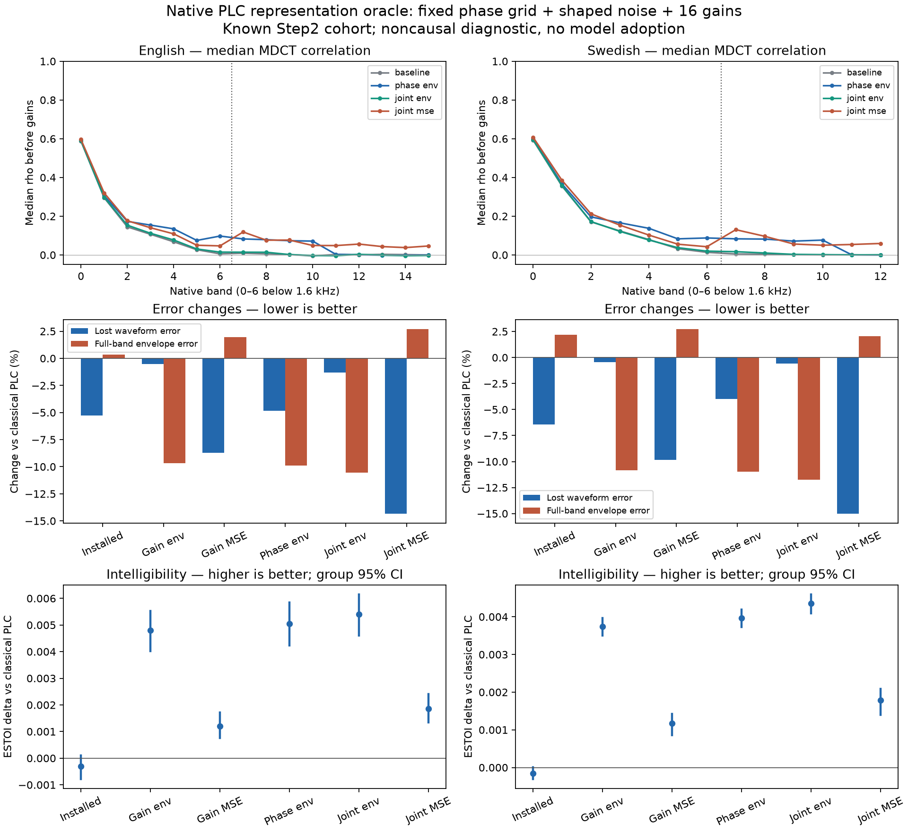

# Native PLC phase and noise representation oracle

## Decision

Constructive noncausal headroom was found: Gain envelope, Phase envelope, Joint envelope pass the prespecified descriptive guard in both languages. **Keep installed weights.** These oracle choices use the lost-frame target and cannot be shipped as causal inference. No GRU or new production head is approved by this result.

This is a noncausal diagnostic on the **already seen Step2 cohort**, not independent acceptance of a model. Installed weights and all production sources remain unchanged. No neural model was trained.

## Frozen experiment

The protocol was committed as `d64d2cd` before corpus evaluation; implementation was committed as `fcda216`. The baseline is main `668597c` (PR29). All variants use the same tight gains `[0.7875, 1.2125]`, native MDCT and actual 120-sample overlap/add and recovery. Scalar read offsets are `0, ±0.5, ±1, ±1.5, ±2, ±2.5, ±3` samples (±62.5µs at 48 kHz). This changes **phase within the repeated pitch cycle**, not its period or future pitch trajectory. Fade is evaluated at the original time and stays unchanged.

A fixed xorshift seed `20261022 + frame_index` supplies one MDCT noise vector per frame. It is orthogonalized to each candidate and normalized to that candidate's energy within each high band (>=1600 Hz). The mix is `sqrt(1-alpha)*pitch + sqrt(alpha)*noise` for `alpha=0,.25,.5,.75,1`. Low bands and zero-energy bands are untouched by noise; there is no seed search or target-dependent noise generation. Band gains still need target information, as does oracle phase/mix selection.

| Variant | Phase / noise selection | Gain target |
|---|---|---|
| Classical | Native |1|
| Installed | Native |Installed i8 MLP|
| Gain envelope |Native|Clamped sqrt(target energy / prediction energy)|
| Gain MSE |Native|Clamped dot(prediction,target) / prediction energy|
| Phase envelope |Maximize mean active-band rho below 4 kHz over 13 offsets; no noise|Envelope|
| Joint envelope |Exhaust all 65 offset/mix pairs; minimize log-energy error in 4-bin subbands (200 Hz at 10 ms, 100 Hz at 20 ms)|Envelope|
| Joint MSE |Exhaust all 65 pairs; minimize supported MDCT error|MSE|

The grid includes the native phase and zero noise. Gains and selection are frame-local; targets are uninterrupted decoded native/Phase1 coefficients. Oracle operations obey the installed PLC safety and fade guards. Each variant keeps actual recovery-history feedback, so its later classical prediction state may differ from other variants. Correlation changes are paired **before/after within each variant**, with matching lost-frame keys; states are not artificially forced equal.

Joint MSE ranks raw supported MDCT error; division by a constant target-energy normalization would leave that frame’s grid ranking unchanged. No selection objective uses ESTOI or the clean source. Both are scored only after native full-clip decoding. All seven variants are reported, without selecting a fallback after results.

## Data and scoring

Exactly the 24 canonical Step2 acceptance utterances: 12 English VCTK speakers and 12 Swedish FLEURS sentence groups; 198.20 s total. Canonical clean/noisy f32 bytes were staged directly from private Drive to a CPU-only Colab VM, and both archive and every PCM hash were verified. No corpus audio was stored on the Mac. This study uses 24 kbps, 10/20 ms, both harmonic modes, clean/noise20/noise10 and six registered loss patterns: **1728 cases per variant, 12096 quality rows**.

The English utterances and speakers, and the Swedish sentences, have already informed earlier design. Swedish speaker identities remain unknown; Swedish uncertainty is conditional on sentence groups. The native 16 kHz Swedish source does not establish full-band speech quality: selection and envelope metrics omit bands 13–15, including the 6.8–9 kHz crossing band; MR-STFT excludes bins above 8 kHz. Gains are still applied to all 16 native bands and audio is fully decoded.

Lost-waveform and low-band MDCT errors are coherent measures against uninterrupted decoded PCM/coefficients. Envelope metrics use the same Step2 energy floor/normalization and native bands, split at 1600 Hz. MR-STFT uses 128/256/512 periodic-Hann windows over **whole decoded clips**, hence includes the full preceding received frame and both loss/recovery boundaries. It is evaluation only, not a new sequence-training loss. STOI/ESTOI reference the original clean canonical PCM. Percent changes below are versus freshly decoded classical PLC; negative error change is better, positive ESTOI delta is better.

The descriptive admission guard requires lower lost-waveform error, full-band envelope ratio<=1 and mean ESTOI delta>=0 **in each language**. It is not a model-adoption gate. Group 95% ESTOI intervals use 2000 paired bootstrap resamples, seed 20261022. No maximum-over-variants or multiple-comparison-adjusted significance claim is made.

## Results

|Variant|Language|Lost waveform error|Low-band MDCT error|Full-band envelope error|MR-STFT error|ESTOI delta [group 95% CI]|
|---|---|---:|---:|---:|---:|---|
|Installed|en|-5.27%|-5.07%|+0.36%|-0.70%|-0.000304 [-0.000788,+0.000097]|
|Installed|sv|-6.43%|-6.31%|+2.18%|-0.04%|-0.000154 [-0.000309,+0.000002]|
|Gain envelope|en|-0.52%|-0.80%|-9.69%|-4.74%|+0.004802 [+0.004016,+0.005519]|
|Gain envelope|sv|-0.44%|-0.85%|-10.84%|-4.18%|+0.003736 [+0.003506,+0.003970]|
|Gain MSE|en|-8.73%|-8.78%|+1.95%|-3.08%|+0.001195 [+0.000757,+0.001710]|
|Gain MSE|sv|-9.84%|-10.13%|+2.75%|-0.78%|+0.001168 [+0.000864,+0.001421]|
|Phase envelope|en|-4.85%|-4.91%|-9.91%|-5.27%|+0.005052 [+0.004236,+0.005843]|
|Phase envelope|sv|-4.00%|-4.07%|-10.95%|-4.63%|+0.003966 [+0.003727,+0.004195]|
|Joint envelope|en|-1.31%|-1.34%|-10.54%|-1.01%|+0.005408 [+0.004606,+0.006153]|
|Joint envelope|sv|-0.58%|-0.96%|-11.75%|-5.60%|+0.004351 [+0.004093,+0.004598]|
|Joint MSE|en|-14.35%|-14.22%|+2.71%|-1.19%|+0.001855 [+0.001340,+0.002415]|
|Joint MSE|sv|-15.03%|-14.95%|+2.07%|-1.79%|+0.001781 [+0.001398,+0.002091]|

Descriptive guard (both languages): Installed FAIL, Gain envelope PASS, Gain MSE FAIL, Phase envelope PASS, Joint envelope PASS, Joint MSE FAIL.

|Matched comparison|Language|Waveform error change|Envelope error change|ESTOI delta|
|---|---|---:|---:|---:|
|Phase envelope vs Gain envelope|en|-4.35%|-0.24%|+0.000250|
|Phase envelope vs Gain envelope|sv|-3.57%|-0.13%|+0.000230|
|Joint envelope vs Gain envelope|en|-0.79%|-0.94%|+0.000606|
|Joint envelope vs Gain envelope|sv|-0.14%|-1.03%|+0.000615|
|Joint MSE vs Gain MSE|en|-6.16%|+0.75%|+0.000660|
|Joint MSE vs Gain MSE|sv|-5.76%|-0.66%|+0.000613|



### Correlation and chosen controls

|Band / Hz|EN classical median rho|EN phase median rho|EN within-state median delta|SV classical median rho|SV phase median rho|SV within-state median delta|
|---|---:|---:|---:|---:|---:|---:|
|0: 0–200|0.5873|0.5917|+0.0001|0.5933|0.5998|+0.0001|
|1: 200–400|0.2954|0.3058|+0.0024|0.3554|0.3664|+0.0024|
|2: 400–600|0.1449|0.1733|+0.0127|0.1709|0.1965|+0.0110|
|3: 600–800|0.1066|0.1541|+0.0172|0.1238|0.1658|+0.0144|
|4: 800–1000|0.0680|0.1347|+0.0234|0.0794|0.1374|+0.0197|
|5: 1000–1300|0.0270|0.0749|+0.0296|0.0321|0.0831|+0.0275|
|6: 1300–1600|0.0058|0.0975|+0.0483|0.0136|0.0877|+0.0445|
|7: 1600–2000|0.0092|0.0827|+0.0568|0.0049|0.0831|+0.0523|
|8: 2000–2500|0.0054|0.0787|+0.0510|0.0037|0.0819|+0.0574|
|9: 2500–3200|0.0019|0.0735|+0.0556|0.0011|0.0714|+0.0512|
|10: 3200–4000|-0.0050|0.0714|+0.0618|0.0003|0.0766|+0.0585|

|Oracle|Language|Eligible frames|Mean absolute offset (samples)|Offset at ±3 boundary|Noise enabled|Mean alpha|
|---|---|---:|---:|---:|---:|---:|
|Phase envelope|en|17212|2.528|71.5%|0.0%|0.000|
|Phase envelope|sv|60624|2.534|71.4%|0.0%|0.000|
|Joint envelope|en|17212|2.117|42.2%|82.3%|0.605|
|Joint envelope|sv|60624|2.253|53.3%|77.7%|0.571|
|Joint MSE|en|17212|2.294|48.6%|47.6%|0.357|
|Joint MSE|sv|60624|2.542|67.3%|51.3%|0.405|

Quartiles cover eligible frames with prediction and target band energy > 1e-10. The report JSON includes per-band before/after and paired-change quartiles, eligible-frame counts, full phase/noise histograms, all quality comparisons and guard outcomes. Selection remains a finite-grid, frame-local diagnostic, not a certified continuous or sequence-level optimum. A positive result constructs an achievable noncausal improvement; a negative result would not establish a representation ceiling. Positive scalar gain cannot change rho, but a phase offset and noise rotation can.

## Verification

- Three new oracle math/safety tests passed on both macOS arm64 and Colab Linux x86_64; noise energy/masking and deterministic seeding, no-history guard, known phase recovery and the sign ambiguity of an envelope-only objective are checked.
- An independent phase audit checked the exact zero-offset path at 7200 sample positions, unchanged fade/silence and integer-offset relationships. All 38 library tests in that local diagnostic copy passed (34 existing, 3 oracle, 1 extra audit); the audit source is preserved in private evidence.
- Seven admission/coverage contract tests passed: MSE-only wins, a regressed language, missing/nonfinite evidence, incomplete/duplicated/unregistered cases and wrong input hashes are rejected.
- Every native replay checked baseline and installed PCM **bit-exactly against the production public APIs**, and every variant preserved received PCM beyond the 120-sample recovery overlap. All outputs were finite and bounded. The synthetic check covered both durations too.
- All 3456 fresh baseline/installed control rows reproduced the prior Step2 wave-error values with maximum relative gap 0. The prior CSV hash was verified; its quality metrics were not reused.
- Native binary, protocol, selection, per-part statistics and every canonical input digest are recorded and checked. This study has no new PyTorch inference or parity claim.
- Production `src/`, Cargo, tests and benches have no diff from the frozen main baseline. The offline diagnostic uses heap allocations and exhaustive search; it is not a runtime latency/footprint benchmark. CI was not used as a merge gate under the user's existing instruction.


## Interpretation and next experiment

The phase-envelope oracle reduces waveform error by an additional **4.35% EN /3.57% SV relative to gain-envelope**, while increasing ESTOI by **0.000250 /0.000230** (both paired group intervals above zero). Thus phase control constructs extra noncausal headroom beyond knowing the 16 band amplitudes. The increase in rho is modest: phase-envelope median rho around 1.6–4 kHz remains about 0.07–0.08, rather than approaching 1. The amplitude/phase conflict is reduced, not removed.

About 71.5% EN /71.4% SV of eligible phase-envelope choices hit ±3 samples. This is a reason not to call the grid a continuous ceiling; a wider phase or period-trajectory study would need its own frozen protocol. The gain-MSE oracle also increases ESTOI in both languages here, despite worsening envelope error. Coherent-loss optimization therefore does not universally imply an ESTOI decrease. The installed model's small negative ESTOI point estimates have group intervals crossing zero on this 24 kbps diagnostic subset.

1. Compare phase-envelope against gain-envelope first: both use the same exact clamped envelope gain rule. Any extra waveform-error reduction constructs additional phase-representation headroom. It does not prove that a causal network can infer the offsets.
2. Gain-envelope itself has target-informed gains. If it improves both perceptual measures and error, the old model's tradeoff cannot be interpreted as a universal gain-only ceiling. Improving causal prediction/selection of the existing gains remains a viable alternative to adding state.
3. The joint-envelope versus phase-envelope comparison changes both the selector objective and the noise degree of freedom. A matched-selector noise ablation is required before attributing an incremental gain specifically to noise, or concluding that both output heads are needed.
4. Before new GPU training, freeze a causal train/validation study with decoded-native targets, a full preceding received frame plus loss/recovery OLA context, and decoded validation ESTOI/envelope guards applied **before** candidate ranking. The existing 80 inputs already include three received-frame f0/voicing values (when available), plus current PLC period/confidence/fade and loss horizon (`src/neural_plc.rs`). Test a simple trajectory/constant control and an MLP phase/noise head on these causal inputs before attributing any gain to a GRU. Use a new acceptance cohort, with new English voices and verified Swedish speaker groups where possible; keep this cohort diagnostic-only.


The phase-only and joint-envelope selectors optimize different objectives. Their difference cannot isolate the causal benefit of the noise control; a positive combined result would require a matched-selector noise ablation. Frame-local spectral gains cannot repair missing band energy beyond their clamp, and energy-preserving noise cannot create energy in an empty band. Negative results therefore do not rule out period trajectories, a broader noise generator, complex spectral corrections or temporal models. Positive oracle results do not prove causal predictability, compact GRU capacity, training convergence, or that exactly two extra outputs suffice.

The control/strength findings from Step2 support a damping interpretation, but do not prove that every coherent-loss model must reduce ESTOI. The MSE-optimal gain is lower than the envelope-optimal gain by the factor rho; it need not be below 1 when target energy is higher. Aggregate error/envelope measurements do not establish the depth or audible severity of individual energy dips. The installed/control comparison also changes training parameterization and optimizer trajectory, so it does not isolate the causal effect of strength alone. Nor does the low-band MSE/envelope association by itself isolate a perceptual cause. The current experiment tests the available representation directly.

## Reproduction and resources

The public tools are `build_plc_representation.py`, `evaluate_plc_representation.py`, `summarize_plc_representation.py`, `test_plc_representation.py` and `plot_plc_representation.py`. Build the diagnostic from the frozen source snapshot in a fresh directory; stage the two canonical input archives on the evaluation host and retain their manifests/attribution. The private artifact contains the exact source payload, executable, 96 native part records, all quality rows and provenance.

```sh
python3 tools/build_plc_representation.py /tmp/snacka-representation-native
python3 tools/evaluate_plc_representation.py acceptance-selection.json /content/canonical /content/evaluation --binary /tmp/snacka-representation-native/target/release/examples/representation --protocol docs/neural-plc-representation-protocol.json --workers 2
python3 tools/summarize_plc_representation.py /content/evaluation report.json
python3 tools/plot_plc_representation.py report.json overview.png
python3 -m unittest discover -s tools -p test_plc_representation.py
```

The canonical parent must contain `en/canonical-en` and `sv/canonical-sv`. Core numerical files remain byte-identical to implementation commit `fcda216`; later commits add analysis, guard tests and reporting. No protocol, grid, candidate objective or admission threshold was changed after outcomes were observed.


One CPU-only Colab session, **approximately 0.08 CU**; balance **1021.06 CU** at 2026-10-22T09:20:33+00:00. The owned session is stopped; final account usage rate 0.00 CU/hour and 0 active assignments. No GPU was allocated and no model was trained. Source audio and canonical PCM remain on private Drive; source/results/evidence are archived there with full SHA-256 readback. Temporary Mac archives are removed after verification.
